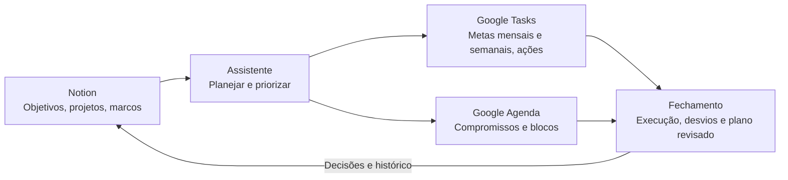

# Agente de Autogestão

Agente pessoal para **planejar objetivos, trabalhar dentro da capacidade real e fechar cada dia com base no que foi executado**. Rode as instruções em Claude, ChatGPT ou Gemini. Mantenha objetivos, projetos e marcos no Notion, metas mensais e semanais e tarefas diárias no Google Tasks, e compromissos e blocos no Google Agenda.

## Comece aqui

1. Abra o [guia de instalação e agendamento](docs/instalacao.md) e escolha seu assistente principal.
2. Copie o [prompt completo](prompts/agente-completo.md) para uma conversa ou para as instruções de um espaço privado do assistente. A versão modular usa [AGENTE.md](AGENTE.md) e a pasta [skills](skills).
3. Configure [Notion, Google Tasks e Google Agenda](docs/modelo-de-dados.md). Rode `PLANEJAR HOJE` e `FECHAR` com o [exemplo fictício](examples/fechamento.md) para conferir a saída.
4. Para a rotina noturna, use o [prompt de fechamento recorrente](prompts/fechamento-recorrente.md). Valide a leitura de tarefas **concluídas** e o horário de corte no seu assistente antes de depender da execução em segundo plano.

## Funcionalidades

| Função | Comando | Resultado |
| --- | --- | --- |
| Planejamento hierárquico | `PLANEJAR projeto` | Vincula objetivo, projeto e marco a metas mensais, semanais e ações com critério de conclusão. |
| Capacidade real e priorização | `PLANEJAR HOJE` | Encaixa o que cabe nas janelas, considerando compromissos, energia, transições, folga e dependências. |
| Check-in rápido | `CHECK-IN` | Coleta só o progresso, bloqueio ou mudança de disponibilidade que afeta a próxima ação. |
| Avaliação diária | `FECHAR` | Compara o planejado com as conclusões registradas e separa parciais, pendências, extras e dados desconhecidos. |
| Replanejamento adaptativo | `REPLANEJAR` | Recalcula esforço restante, realoca trabalho flexível e propõe revisões de escopo ou prazo quando necessário. |
| Hábitos e retomada | `ROTINA` | Cria uma rotina com âncora, ação mínima e forma de recuperar a execução. |
| Verificação de entregas | `VERIFICAR` | Confere condições críticas e aprovações antes de avançar. |
| Revisão semanal, mensal e de ciclo | `REVISAR` | Compara o placar de execução com os resultados e define um teste de melhoria. |

## Livros e skills

As skills abaixo consolidam o material fornecido por função. Uma mesma skill aparece junto a cada livro que contribui para ela. Procedimentos de integração, fuso, margem, evidência e autorização são convenções do agente. As capas são vinculadas às respectivas fontes de catálogo.

| Capa | Livro e skills operacionais |
| --- | --- |
|  | **A arte de fazer acontecer** · David Allen O método GTD organiza pendências em próximas ações, projetos e esperas. A revisão mantém os compromissos visíveis e os critérios de engajamento ajudam a escolher o que fazer no tempo disponível. [Fonte da capa](https://sextante.com.br/products/a-arte-de-fazer-acontecer-o-metodo-gtd-getting-things-done)  [**Planejamento hierárquico**](skills/planejamento-hierarquico/SKILL.md) — Traduz objetivos e marcos em metas com indicadores, dependências e próximas ações. [**Capacidade real**](skills/capacidade-real/SKILL.md) — Desconta sobreposições, transições e margem. Prioriza ações prontas que cabem nas janelas. [**Replanejamento adaptativo**](skills/replanejamento-adaptativo/SKILL.md) — Recalcula o plano, redistribui ações e propõe mudanças de escopo ou prazo com impacto rastreável. [**Revisão periódica**](skills/revisao-periodica/SKILL.md) — Compara táticas e resultados, identifica o gargalo e escolhe um experimento de melhoria. |
|  | **A Meta** · Eliyahu M. Goldratt e Jeff Cox O romance acompanha uma fábrica que precisa recuperar seu desempenho. A Teoria das Restrições orienta o agente a proteger a etapa que limita a entrega e a ajustar o trabalho em andamento. [Fonte da capa](https://www.seboterapia.com.br/a-meta-eliyahu-m-goldratt-e-jeff-cox-----)  [**Capacidade real**](skills/capacidade-real/SKILL.md) — Desconta sobreposições, transições e margem. Prioriza ações prontas que cabem nas janelas. [**Replanejamento adaptativo**](skills/replanejamento-adaptativo/SKILL.md) — Recalcula o plano, redistribui ações e propõe mudanças de escopo ou prazo com impacto rastreável. [**Revisão periódica**](skills/revisao-periodica/SKILL.md) — Compara táticas e resultados, identifica o gargalo e escolhe um experimento de melhoria. |
|  | **Checklist** · Atul Gawande Investiga como pausas breves de verificação e comunicação reduzem omissões em trabalhos complexos. O agente usa esses princípios em entregas críticas e na confirmação de evidências. [Fonte da capa](https://sextante.com.br/products/checklist)  [**Check-in rápido**](skills/checkin-rapido/SKILL.md) — Coleta só as mudanças que afetam a execução e indica a próxima ação. [**Fechamento diário**](skills/fechamento-diario/SKILL.md) — Reconcilia o plano com as conclusões do Tasks e separa pendências, parciais, extras e lacunas. [**Checklist crítico**](skills/checklist-critico/SKILL.md) — Cria pausas curtas e verifica evidências, versões e dependências de entregas críticas. |
|  | **Hábitos Atômicos** · James Clear Explica como pistas, ambiente, facilidade e reforço influenciam a repetição. O agente aplica esses princípios ao começo das tarefas, ao acompanhamento e à retomada após interrupções. [Fonte da capa](https://altabooks.com.br/produto/habitos-atomicos/)  [**Check-in rápido**](skills/checkin-rapido/SKILL.md) — Coleta só as mudanças que afetam a execução e indica a próxima ação. [**Fechamento diário**](skills/fechamento-diario/SKILL.md) — Reconcilia o plano com as conclusões do Tasks e separa pendências, parciais, extras e lacunas. [**Replanejamento adaptativo**](skills/replanejamento-adaptativo/SKILL.md) — Recalcula o plano, redistribui ações e propõe mudanças de escopo ou prazo com impacto rastreável. [**Hábitos e retomada**](skills/habitos-e-retomada/SKILL.md) — Vincula rotinas a gatilhos confiáveis, facilita o início e define uma forma de retomada. [**Revisão periódica**](skills/revisao-periodica/SKILL.md) — Compara táticas e resultados, identifica o gargalo e escolhe um experimento de melhoria. |
|  | **O Ano de 12 Semanas** · Brian P. Moran e Michael Lennington Organiza a execução em ciclos curtos, com resultados definidos, táticas semanais e um placar de execução. A capa mostra a edição brasileira publicada como 1 Ano em 12 Semanas. [Fonte da capa](https://altabooks.com.br/produto/1-ano-em-12-semanas/)  [**Planejamento hierárquico**](skills/planejamento-hierarquico/SKILL.md) — Traduz objetivos e marcos em metas com indicadores, dependências e próximas ações. [**Capacidade real**](skills/capacidade-real/SKILL.md) — Desconta sobreposições, transições e margem. Prioriza ações prontas que cabem nas janelas. [**Fechamento diário**](skills/fechamento-diario/SKILL.md) — Reconcilia o plano com as conclusões do Tasks e separa pendências, parciais, extras e lacunas. [**Replanejamento adaptativo**](skills/replanejamento-adaptativo/SKILL.md) — Recalcula o plano, redistribui ações e propõe mudanças de escopo ou prazo com impacto rastreável. [**Revisão periódica**](skills/revisao-periodica/SKILL.md) — Compara táticas e resultados, identifica o gargalo e escolhe um experimento de melhoria. |

A [rastreabilidade das skills](docs/rastreabilidade.md) mostra quais materiais de origem sustentam cada rotina.
